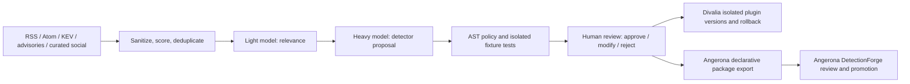

# Divalia 2.0

An independent, optional threat intelligence and detection research companion for
[Angerona Security Suite](https://github.com/Ag3nt47/AngeronaSuite). Angerona runs
without Divalia. Divalia installs into its own environment and keeps separate state.

Divalia collects curated intelligence, filters it with a lightweight model,
asks a heavier model for an observe-only detector, audits its AST, tests it in
an isolated container, and presents the evidence for human review. Automation
never approves or deploys a candidate.



## Install and try it

Requires Python 3.11 or newer. Windows, Linux and macOS use the same CLI.

```powershell
git clone https://github.com/Ag3nt47/Divalia.git
cd Divalia
python -m venv .venv
.venv\Scripts\python.exe -m pip install -e .
.venv\Scripts\divalia.exe init
.venv\Scripts\divalia.exe demo
.venv\Scripts\divalia.exe --config divalia.toml doctor
```

On Linux/macOS use `.venv/bin/python` and `.venv/bin/divalia`. The offline demo
checks an AST and exports a declarative fixture package without a model, Docker,
API key or Angerona installation. It does not claim container testing occurred.

Edit `divalia.toml` to select feeds, models and the sandbox image. API keys are
never part of this file. [config.example.toml](config.example.toml) documents all
settings. See [operations](docs/operations.md) for a complete workflow.

## Models and API keys

Model names are configurable strings; choose models supported by your runtime
and hardware. The two model roles can use different providers and credentials.

| Provider | Configuration | Credential |
| --- | --- | --- |
| Ollama | `provider = "ollama"`; literal loopback endpoint | Usually none |
| LM Studio | `provider = "lmstudio"`; loopback `/v1` endpoint | Optional `key_env` |
| llama.cpp | `provider = "llamacpp"`; loopback `/v1` endpoint | Optional `key_env` |
| Custom compatible/FastAPI endpoint | `provider = "compatible"`; chat-completions protocol | Optional `key_env` |
| OpenAI | `provider = "openai"`; `allow_remote = true` | `OPENAI_API_KEY` |
| Anthropic | `provider = "anthropic"`; `allow_remote = true` | `ANTHROPIC_API_KEY` |
| Gemini | `provider = "gemini"`; `allow_remote = true` | `GEMINI_API_KEY` |

`key_env` names an environment variable populated by your shell, service manager
or secret manager. Divalia does not load `.env` files, print credentials or write
keys into configuration. Remote adapters use fixed official API hosts; custom
remote compatible endpoints require explicit HTTPS configuration and opt-in.
There is no automatic local-to-cloud fallback. Remote inference sends selected
threat briefing text to the chosen provider; do not include private telemetry in
briefings unless you intend that disclosure.

Example: keep filtering local and select a remote reasoning model yourself:

```toml
[ai]
provider = "ollama"
endpoint = "http://127.0.0.1:11434"
light_model = "YOUR_LOCAL_FILTER_MODEL"
heavy_model = "YOUR_LOCAL_CODE_MODEL"
allow_remote = false

[ai.heavy]
provider = "openai"
heavy_model = "YOUR_CHOSEN_REMOTE_MODEL"
key_env = "OPENAI_API_KEY"
allow_remote = true
```

`divalia providers` lists adapters. Additional provider protocols implement
[`BaseProvider`](src/divalia/ai/base_provider.py), which is also injectable into
the synthesis pipeline. Optional runtime setup checks Ollama readiness and can
pull explicitly requested models:

```powershell
divalia --config divalia.toml runtime
divalia --config divalia.toml runtime --pull YOUR_CHOSEN_MODEL --consent
```

The runtime downloader accepts an official HTTPS installer URL, a separately
verified SHA-256 and explicit consent. It saves the installer for operator
review; it does not execute downloaded scripts or silently install engines.

## Isolated Python testing

Generated code is never executed on the host. A trusted Linux Docker worker is
required for Python candidate validation, approval and runtime events. Without
it, candidates remain blocked. An AST score of 100 means the current allowlist
found no violations; it is not a probability or security guarantee.

Build the worker from a reviewed CPython Linux base pinned by digest or local
immutable image ID. Set the resulting worker ID as `[sandbox].image`:

```powershell
docker pull python:3.12-slim
# Review the resolved image before proceeding; a mutable tag is not a trust decision.
$baseImage = docker image inspect python:3.12-slim --format '{{index .RepoDigests 0}}'
docker build --build-arg "BASE_IMAGE=$baseImage" -t divalia-worker src/divalia/harness
docker image inspect divalia-worker --format '{{.Id}}'
```

Copy the returned `sha256:...` worker ID to your configuration. Registry
`repository@sha256:...` references are also supported when installed locally.
Divalia never pulls an image automatically. Each test drops capabilities,
uses an unprivileged user, disables networking and host mounts, makes the root
filesystem read-only, and limits memory, CPU, processes, output and duration.
Docker Desktop must use Linux containers on Windows.

## Angerona integration

The supported exchange is a digest-sealed, optionally Ed25519-signed
`sigma-subset` JSON detection package. Import it into Angerona's DetectionForge
and use its existing review, trusted publisher enrollment, replay quality and
promotion workflow. Compatibility is tested against Angerona's actual package
loader. Divalia never edits its registry or manufactures promotion receipts.

Angerona's external Python module loader requires signed manifests and a restart;
it has no supported source-code hot-reload hook. Divalia's atomic replacement
and probation rollback apply to its own isolated plugin runtime. Angerona live
activation and rollback remain owned by its existing authorities.

A pinned-commit/SHA-256 [download hook](src/divalia/integration/downloader.py)
is available to an optional future Angerona settings integration. This release
does not add a settings button, expose an HTTP server, or change Angerona.

## Current boundaries

- Python detectors use a deliberately small, pure `detect(event)` subset.
  Native Go parsing/execution is unsupported and rejected.
- Source credibility and local token-vector deduplication reduce repetition;
  cross-reporting is not independent artifact verification. Reference URLs are
  evidence pointers, not authenticated proof or permission to execute content.
- Tests exercise synthetic hit/miss fixtures repeatedly and record resource
  observations. They cannot prove all leaks, deadlocks or detection mistakes
  are absent. Each live event uses a separate container: this is a research
  harness, not Angerona's high-throughput sensor path.
- Local operators and the state directory are trusted. See
  [SECURITY.md](SECURITY.md) for the full trust model and recovery constraints.

## Development

```powershell
python -m pip install -e ".[dev]"
python -m ruff check src tests tools
python -m compileall -q src tools
python -m pytest -q
python -m divalia demo
python -m build
```

Offline tests never call paid APIs or execute generated Python on the host.
The GitHub workflow includes Linux/Windows Python 3.11–3.13 checks and a separate
real Linux-container test job. Opt-in integration checks and local validation
results are documented in [validation](docs/validation.md).

Project structure and provider protocol references are in
[architecture](docs/architecture.md). License: [MIT](LICENSE).
